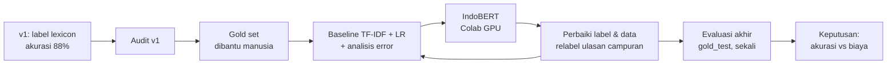

# Sentiment Analysis MyTelkomsel — dari v1 ke v2: sebuah improvement workflow

Proyek ini berawal dari model sentimen ulasan Google Play aplikasi MyTelkomsel (v1) yang tampak bagus di atas kertas,
dengan akurasi 88%, tetapi gagal saat dinilai terhadap label manusia. Dokumen ini mencatat langkah perbaikannya,
angka di setiap langkah, dan alasan model akhir yang dipilih adalah model yang **lebih kecil**.

## Ringkasan

| | v1 (awal) | v2 (akhir) |
|---|---|---|
| Sumber label training | lexicon kata positif/negatif | rating bintang (weak label) yang dibersihkan |
| Dievaluasi terhadap | label lexicon itu sendiri | **gold set berlabel manusia** |
| Macro-F1 di gold_test (n = 248) | **0,496** ¹ | **0,898** |
| Benar pada ulasan sarkastik di gold_test | 2 dari 10 ¹ | 8 dari 10 |
| Model final | SVM + TF-IDF | TF-IDF (kata + karakter) + Logistic Regression, 1,6 MB |

¹ Diukur dari label lexicon yang ditiru model v1. Model SVM v1 sendiri tidak tersimpan, tetapi kesepakatannya dengan
lexicon 88%, jadi angkanya diperkirakan mirip.

Tiga temuan utama:
1. **Akurasi 88% di v1 hanya berarti "88% mirip lexicon".** Begitu dinilai dengan label manusia, macro-F1 label
   tersebut 0,496.
2. **Kenaikan terbesar datang dari data dan label, bukan dari model yang lebih besar.** Memperbaiki filter data
   latih, aturan label, dan threshold menaikkan baseline dari 0,789 ke 0,866 di gold_val (irisan yang dilihat manusia).
3. **IndoBERT (~500 MB) tidak lebih baik secara bermakna dari baseline 1,6 MB** (gold_test 0,894 vs 0,898), padahal
   jauh lebih mahal. Model kecil dipilih.

## Workflow

Prinsip yang dipegang di semua langkah:
- **Gold set dipisah dua.** `gold_val` (248) untuk memilih dan menganalisis, `gold_test` (248) dibuka sekali di akhir.
  Pembagiannya permanen (`data/gold_split.csv`), dan setiap pembukaan gold_test dicatat di `models/final_test_log.jsonl`.
- **Metrik utama macro-F1**, bukan akurasi, karena 86% ulasan di gold set adalah keluhan.
- **Setiap angka berasal dari output notebook** dan menyebut dataset evaluasinya.

### 1. Audit v1: apa yang sebenarnya diukur

Model v1 (`01_v1_lexicon.ipynb`) dilatih dan diuji dengan label dari lexicon:

| Temuan | Bukti |
|---|---|
| Label lexicon berbeda jauh dari rating | 41,5% positif menurut lexicon vs 10,9% menurut rating (12.000 ulasan v1) |
| Skor 0 dianggap positif, tidak ada netral | `score >= 0 → positive` |
| Kata negasi dibuang sebelum dinilai | "tidak", "bukan", "belum", "jangan", "kurang" ada di stopword NLTK; ulasan yang masih memuat negasi setelah preprocessing tinggal 2,8% (dari 31,5%) ² |
| Lexicon bertentangan dengan dirinya sendiri | "bagus" bernilai −2; **semua** 383 ulasan berisi "bagus" saja (rata-rata ★4,7) berlabel negatif ² |
| Overfit dan pemilihan model di test set | SVM train 99,5% vs test 88,3%; dipilih berdasarkan train accuracy |
| Urutan scraping | `MOST_RELEVANT` condong ke ulasan negatif (85% bintang 1–2 vs 64% untuk `NEWEST`) ² |

² Reproduksi pipeline v1 pada 15.000 ulasan terbaru (30 Sep 2026) di audit terpisah.

### 2. Gold set: manusia sebagai hakim

Melabeli 500 ulasan sepenuhnya manual itu berat. Karena itu dipakai pelabelan **berbantuan LLM yang dikalibrasi**:

1. **98 ulasan dilabeli buta oleh manusia**, tanpa rating dan tanpa label LLM.
2. **Label LLM dibandingkan dengan label manusia.** Pada 50 sampel acak, kesepakatannya 98% (κ = 0,90).
3. **400 ulasan lain dipra-label LLM.** Manusia memeriksa 58 baris yang ragu dan 50 baris audit acak. Di baris audit,
   koreksinya 0 dari 50.
4. **Setelah analisis error (langkah 4), 116 ulasan campuran dilabeli ulang** dengan aturan yang lebih tegas.

Hasilnya 496 ulasan gold. **280 di antaranya dilihat langsung oleh manusia**, dan setiap evaluasi juga dilaporkan
khusus untuk irisan itu.

### 3. Baseline dan analisis error

Baseline: TF-IDF kata + karakter dengan Logistic Regression. Training memakai rating sebagai *weak label*
(★1–2 = keluhan, ★4–5 = bukan keluhan, ★3 dibuang), 7.474 ulasan setelah dedup dan filter. Preprocessing baru
mempertahankan negasi, emoji, `!`/`?`, dan angka paket.

Analisis 25 kesalahan baseline pertama di gold_val:

| Pola | n | Contoh |
|---|---:|---|
| Keluhan ringan / sopan | 11 | "aplikasinya kadang lambat", "paket cepat habis… thanks 🙏" |
| Campuran pujian + keluhan | 7 | "jaringannya walaupun bagus tapi ngleg" |
| Sarkasme / ironi | 3 | "sengaja kasih bintang 5 biar diatas…" |
| Negasi / idiom | 3 | "cinta Telkomsel sampai mati" |
| Lainnya | 1 | keluhan berbasis angka |

20 dari 25 kesalahan adalah **keluhan yang diprediksi positif**. Penyebabnya ada di data latih: ulasan bintang 5
yang isinya keluhan sopan lolos sebagai "positif".

### 4. Perbaikan berulang (semua dinilai di gold_val)

| Langkah | Perubahan | Macro-F1 semua / dilihat manusia |
|---|---|---|
| Baseline awal | — | 0,829 / 0,789 |
| Filter B | ulasan ★4–5 berisi keluhan ringan dibuang dari training | 0,865 / 0,835 |
| Relabel campuran | aturan: *"ada masalah nyata yang belum selesai → keluhan"*; 116 ulasan dicek ulang | 0,860 / 0,818 ³ |
| **Filter C + threshold** | ulasan ★4–5 berpola "pujian **tapi** keluhan" dibuang; threshold dipilih di validasi rating (0,60) | **0,893 / 0,866** |

³ Label berubah di langkah ini, jadi angkanya tidak sepenuhnya sebanding dengan baris di atasnya.

### 5. IndoBERT: apakah model Transformer sepadan?

`indobenchmark/indobert-base-p1` di-fine-tune di Google Colab (Tesla T4). Notebook Colab hanya menerima **teks** gold,
tanpa label, sehingga penilaian tetap di satu tempat. Ada tiga run:

| Run | Data | Epoch | Threshold | gold_val semua / manusia |
|---|---|---:|---|---|
| 1 | filter B | 4 | 0,5 | 0,881 / 0,841 |
| 2 | filter C | 4 | 0,5 | 0,881 / 0,850 |
| 3 | filter C | 2 | 0,85 (dipilih di validasi rating) | 0,905 / 0,886 |

IndoBERT run 3 sedikit di atas baseline di gold_val. Selisihnya tidak bermakna: IndoBERT memperbaiki 6 ulasan dan
merusak 5 (McNemar p = 1,0), dan interval bootstrap selisihnya mencakup nol.

## Hasil akhir (gold_test, dibuka sekali)

| Model | Semua (n = 248) | Dilihat manusia (n = 135) |
|---|---:|---:|
| v1: label lexicon | 0,496 | 0,505 |
| **v2: Baseline TF-IDF + LR** | **0,898** | **0,853** |
| v2: IndoBERT run 3 | 0,894 | 0,847 |

| Biaya | Baseline | IndoBERT |
|---|---|---|
| Ukuran model | 1,6 MB | ~500 MB |
| Inferensi 100 ulasan (CPU Mac) | 0,011 s | 2,19 s |
| Training | detik, CPU | 2 menit, GPU |

**Keputusan:** baseline TF-IDF + LR menjadi model utama. Akurasinya setara dengan IndoBERT di data yang tidak pernah
dipakai untuk mengambil keputusan, sementara biayanya jauh lebih ringan untuk dijalankan harian, di-deploy di hosting
gratis, dan dilatih ulang. IndoBERT tetap dilaporkan sebagai pembanding.

## Transformer, LLM, dan kenapa model kecil masih relevan

IndoBERT adalah **Transformer encoder** (keluarga BERT): ia membaca seluruh kalimat sekaligus untuk memahami konteks.
LLM seperti GPT dibangun dari arsitektur yang sama, **Transformer decoder**, yang dilatih untuk menghasilkan teks.
Jadi eksperimen IndoBERT di sini memakai fondasi yang sama dengan LLM masa kini.

Lalu kenapa memilih model kecil? Karena untuk tugas yang sempit dan jelas (keluhan atau bukan), proyek ini menunjukkan:
- **Model 1,6 MB setara dengan model 500 MB.** Batas akurasi lebih ditentukan oleh kualitas label daripada ukuran model.
- **Biaya dan kecepatan penting.** Model kecil berjalan di CPU 200× lebih cepat, tanpa GPU, dan bisa dilatih ulang
  dalam hitungan detik.
- **Kendali dan audit lebih mudah.** Data ulasan pelanggan tidak perlu dikirim ke layanan luar, dan perilaku model
  bisa diperiksa.
- **Disiplin evaluasi berlaku untuk semua model, termasuk LLM.** Tanpa gold set berlabel manusia, angka 88% di v1
  terlihat meyakinkan padahal salah arah.

## Keterbatasan

- **Sarkasme masih lemah**, dan irisannya kecil (10 ulasan di gold_test), jadi angkanya kasar.
- **Gold set kecil.** Dengan 36 ulasan positif di gold_test, selisih beberapa poin bisa saja kebetulan.
- **216 baris gold masih label LLM yang belum diperiksa manusia.** Karena itu angka irisan "dilihat manusia" juga
  dilaporkan.
- **Klasifikasinya 2 kelas** (keluhan vs bukan keluhan). Kelas netral digabung ke "bukan keluhan".
- **Data training memakai rating sebagai weak label**, yang tetap berisik walaupun sudah difilter.

## Langkah berikutnya

1. **LLM khusus untuk kasus sulit.** Ulasan yang tidak disepakati kedua model (±4% di gold_val) atau terdeteksi sarkastik
   diteruskan ke LLM zero-shot atau ke manusia.
2. **Perbanyak gold set**, terutama ulasan positif dan sarkastik.
3. **Sentimen per aspek** (jaringan, harga, aplikasi), lalu draf balasan otomatis dengan persetujuan manusia.

## Tiga versi notebook

| Notebook | Versi | Isi | Dijalankan di |
|---|---|---|---|
| `01_v1_lexicon.ipynb` | v1 | label lexicon, SVM / LR / voting ensemble; arsip, kode tidak diubah | Colab (asli) |
| `02_v2_baseline_tfidf_lr.ipynb` | v2 | **notebook utama**: data, preprocessing, gold set, baseline TF-IDF + LR, analisis error, penilaian IndoBERT, evaluasi akhir gold_test | lokal, CPU |
| `03_v2_indobert_colab.ipynb` | v2 | fine-tune IndoBERT; hanya training dan prediksi (menerima teks gold tanpa label) | Colab, GPU |

`02` dan `03` saling terhubung: `02` mengekspor `data/bert_data.zip`, `03` mengembalikan `indobert_results.zip`
yang diekstrak ke `data/bert/`. Dengan begitu kedua model dinilai dengan gold set dan kode yang sama.

Pada salinan `01`, output tabel yang memuat nama pengguna dan URL foto profil Google Play sudah dihapus.

## File

| File | Isi |
|---|---|
| `data/gold_final.csv`, `data/gold_split.csv` | gold set dan pembagian val/test |
| `data/1_…`, `2_…`, `3_…`, `4_relabel_campuran.csv` | lembar pelabelan manusia dan pra-label LLM |
| `data/4_PANDUAN_relabel_campuran.md` | aturan label ulasan campuran |
| `data/errors_gold_val*.csv` | kesalahan baseline di gold_val (yang awal beserta kategorinya) |
| `data/bert/run*/` | hasil ketiga run IndoBERT; `data/bert/manifest_history.jsonl` = versi data tiap ekspor |
| `models/baseline_tfidf_lr.joblib`, `models/baseline_report.json` | model baseline final dan laporan gold_val |
| `models/final_test_report.json`, `models/final_test_log.jsonl` | hasil gold_test dan catatan setiap pembukaannya |

## Cara menjalankan

1. Data mentah `data/reviews_raw.csv` (12.000 ulasan terbaru, 23 Agu – 6 Okt 2026) tidak ikut di repo. Untuk mengambil ulang,
   set `RUN_SCRAPE = True` di bagian 0 notebook `02`. Hasil scraping di hari lain akan berbeda, dan gold set
   bergantung pada `reviewId` dari scraping awal.
2. Buka `02_v2_baseline_tfidf_lr.ipynb`, lalu *Restart & Run All* (Python 3.11, `pandas`, `scikit-learn`, `joblib`).
   Hasil IndoBERT dibaca dari `data/bert/`.
3. Untuk melatih ulang IndoBERT, ikuti petunjuk di bagian 7 notebook `02` dan jalankan `03` di Colab.
4. `RUN_FINAL_TEST` di bagian 0 sengaja `False`. Gold_test sudah dibuka untuk evaluasi akhir; membukanya lagi
   tercatat di `models/final_test_log.jsonl`.
